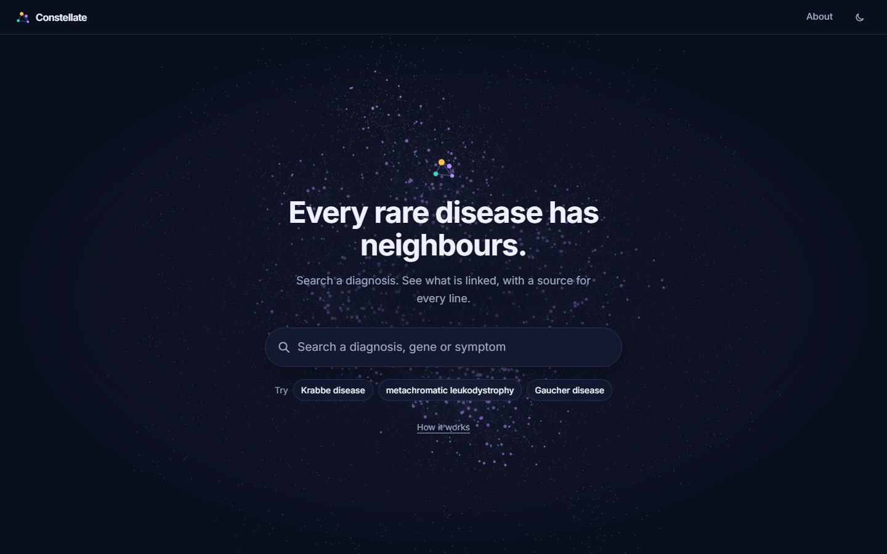
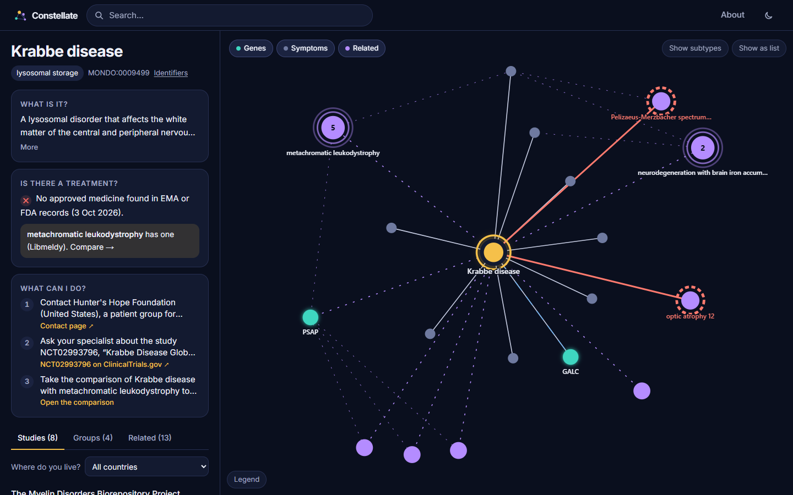
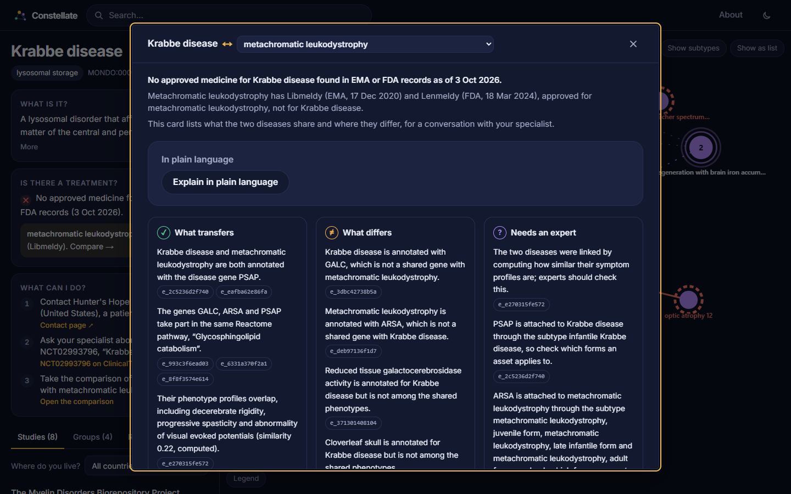

# Constellate

*Five thousand points of light. One map to see the constellations.*

An evidence-graded knowledge graph for rare diseases, started at the Hack-Nation 7th Global AI Hackathon (Challenge 05, „AI Atlas for the World's Rare Diseases", Buffalo Initiative × OpenAI) and developed further since.

Constellate organizes rare diseases by **mechanism and phenotype instead of name**, and walks a patient-group leader from her diagnosis to a mechanistically related community, a reusable asset (registry, natural-history study design) and a sourced proposal she can send this week. Every edge carries its source, date, evidence level and counter-evidence. When there is no supported lead, Constellate says so and shows what was searched.

Current state: [docs/STATUS.md](docs/STATUS.md), changes and open points: [docs/CHANGELOG.md](docs/CHANGELOG.md). Run it locally: `cd app && npm install && npm run dev` (the exported data is committed, no pipeline run needed).

**Live demo:** https://constellate-omega.vercel.app · **Repository:** https://github.com/Reczec/constellate







## Why

10,000 rare diseases, 80 % genetic, fewer than 5 % with an approved therapy (challenge brief). The knowledge to connect them exists in OMIM, HPO, PubMed, ClinicalTrials.gov, NIH RePORTER and hundreds of patient-group sites, but it is not linked. Patient groups rebuild registries and studies that a neighbouring community already has, because names hide mechanisms: one gene (PSAP) sits behind three disease names (Krabbe, metachromatic leukodystrophy, Gaucher): saposin A deficiency looks like Krabbe (OMIM 611722), saposin B deficiency like MLD (OMIM 249900), saposin C deficiency like Gaucher (OMIM 610539).

## The problem, the solution, the user

Problem: a family gets a rare diagnosis with no approved treatment and becomes, within months, the organizer of a research effort it never planned to lead. The knowledge it needs is scattered, groups rebuild registries that already exist next door, and disease names hide shared mechanisms (challenge brief).

Solution: a graph organized by mechanism and phenotype, where every edge carries its source, date, evidence level and counter-evidence, and where a missing link is shown as a finding (the Honest Gap), not papered over.

User: one composite mother in two moments (a composite persona, not a real person). Moment 1, "We just got the diagnosis": find a community for the exact diagnosis or an honest answer, plus open studies. Moment 2, "I lead a patient group": find a mechanistically related community, join an existing study or registry instead of building one, and send a sourced Action Card. The four personas of the brief (Maria, Devon, Priya, Dr. Osei) remain as secondary lenses.

## What you can do in the demo

1. Search one box for a disease, gene, symptom, mechanism or patient group.
2. See the ego-graph: genes, phenotypes, pathways, neighbouring diseases, trials, grants, papers, patient groups.
3. Click any edge: source record, date, evidence level (`observed` · `curated` · `text_mined` · `inferred`), confidence, counter-evidence.
4. Open the **Action Card**: what transfers, what differs, what needs expert review, each sentence citing an edge.
5. Hit a real gap: the **Honest Gap** screen lists the sources searched, the date and the next question to test.

## Demo path (hero path and counter-example)

Hero path: Krabbe disease (MONDO:0009499) → GALC / PSAP → metachromatic leukodystrophy (MLD) → ARSA → gene therapy and natural-history precedent → Action Card. Each step carries its primary source; nothing here is from model memory.

| Step | What the app shows | Primary source |
|---|---|---|
| 1 | Krabbe disease has no approved drug; stem-cell transplant helps only before symptoms | GeneReviews NBK1238; Escolar et al., NEJM 2005, PMID 15901860 |
| 2 | Krabbe → GALC (curated edge from OMIM 245200) | OMIM 245200; edge `e_3dbc42738b5a` in the current export |
| 3 | One gene, three names: PSAP behind Krabbe-like, MLD-like and Gaucher-like disease | OMIM 611722, 249900, 610539 |
| 4 | MLD and ARSA as the mechanistic neighbour | OMIM 250100; Orphanet 512 |
| 5 | MLD has an approved gene therapy (EU 17.12.2020, FDA 18.03.2024), shown effective against a natural-history control cohort (29 treated vs. 31 untreated children) | EMA EPAR Libmeldy; FDA press release 18.03.2024; Fumagalli et al., Lancet 2022, PMID 35065785 |
| 6 | Reusable assets: the MLD natural-history study and the GMFC-MLD motor scale | NCT04628364 (HOME study, sponsor NORD); Kehrer et al. 2011, PMID 21707604 |
| 7 | Action Card: what transfers, what differs, what needs expert review, each sentence ending in its edge id | generated from the edges above (Explain) |

Counter-example: Pelizaeus-Merzbacher disease (PLP1) looks similar (white matter involvement, spasticity, nystagmus) but is hypomyelinating and not lysosomal, so lysosomal assets do not transfer (OMIM 312080; Orphanet 702; PMC9313024). Constellate flags such pairs automatically as `mechanism_differs`.

Honest Gap: when a diagnosis has no supported lead, the screen lists the sources searched with the date, the nearest related communities (with the reason) and the next question to test. The demo case is `MONDO:0012720` (Krabbe disease due to saposin A deficiency); open decisions are in [docs/DECISIONS.md](docs/DECISIONS.md).

## Architecture

Offline Python pipeline → static JSON shards in `app/public/data/` (the data contract, see [app/README.md](app/README.md)) → Next.js app. OpenAI at exactly three points: **Extract** (abstracts → claims, Structured Outputs), **Reconcile** (names → stable IDs), **Explain** (graph path → plain language with a citation per sentence). Details and the data model: [docs/ARCHITECTURE.md](docs/ARCHITECTURE.md). There is no graph database: the dataset is static JSON, so no server can fail during a demo.

```mermaid
flowchart LR
  SRC["Open sources<br/>HPO, MONDO, Orphanet, ClinVar,<br/>ClinicalTrials.gov, Europe PMC,<br/>NIH RePORTER, Open Targets, Reactome,<br/>curated patient-org list"]
  subgraph PIPE["pipeline/ (Python, uv)"]
    P1["01 fetch"] --> P2["02 slice"] --> P3["03 build graph"] --> P4["04 enrich APIs"]
    P4 --> P5["05 EXTRACT<br/>OpenAI: abstracts to claims"]
    P5 --> P6["06 RECONCILE<br/>OpenAI: names to MONDO ids"]
    P6 --> P7["07 analytics<br/>IC, simGIC, Resnik, Louvain, counter-examples"]
    P7 --> P8["08 trial details<br/>countries, sites, ages"]
    P7 --> V["validate.py"]
  end
  DATA[("app/public/data/<br/>meta, index, core,<br/>shards per disease, gene,<br/>phenotype, trial")]
  subgraph APP["app/ (Next.js 15, Vercel)"]
    UI["search - ego graph - edge panel<br/>Action Card - Honest Gap - open studies"]
    EX["/api/explain<br/>EXPLAIN: OpenAI, one citation per sentence"]
  end
  SRC --> P1
  P8 --> DATA
  V -.checks.-> DATA
  DATA --> UI
  UI --> EX
```



## Reproduce the dataset

```bash
cp .env.example .env.local   # add OPENAI_API_KEY
make setup
make reproduce               # fetch → slice → build → enrich → extract → reconcile → analytics → trials
make validate                # checks app/public/data/ against the data contract (must be green)
make dev                     # http://localhost:3000
make test                    # pipeline unit tests (no network, no keys)
```

`make reproduce` needs network access to the public sources listed below (HPO, MONDO and Orphanet bulk files plus the ClinicalTrials.gov, Europe PMC, NIH RePORTER, Open Targets, Reactome, ClinVar and mygene APIs). Single steps: `make fetch`, `make slice`, `make build`, `make enrich`, `make extract`, `make reconcile`, `make analytics`, `make trials`.

Raw downloads are cached in `data/raw/` (gitignored) and logged with URL, date and sha256 in [data/MANIFEST.md](data/MANIFEST.md). Without an OpenAI key, `extract` and `reconcile` fall back to curated edges and fuzzy matching; the graph still builds.

## Scope

One cluster deep: 350 core diseases (MONDO subtrees lysosomal storage disease, MONDO:0002561, and leukodystrophy, MONDO:0019046) plus 524 neighbours picked by shared gene or phenotype similarity. Hero path and counter-example: [docs/SCOPE.md](docs/SCOPE.md). Medical background: [docs/MEDICAL-BACKGROUND.md](docs/MEDICAL-BACKGROUND.md).

## Data sources and licenses

See [docs/DATA-SOURCES.md](docs/DATA-SOURCES.md). HPO (free with attribution) · MONDO CC-BY 4.0 · Orphanet/Orphadata CC-BY 4.0 · ClinVar, ClinicalTrials.gov, PubMed, NIH RePORTER: US public domain · Open Targets CC0 · Reactome CC0 (reactome.org/license) · Monarch CC-BY 4.0. OMIM content enters only indirectly via HPO annotations and Orphanet cross-references. Patient organisations are hand-verified from their public websites (`data/curated/orgs.csv`, with verification date).

The code is MIT-licensed (see [LICENSE](LICENSE)). The MIT license covers the code only; the data in `app/public/data` keeps the licenses of its sources listed above.

## Evidence model

| Level | Meaning | Typical source |
|---|---|---|
| `observed` | clinically or experimentally observed, curated with primary source | ClinVar pathogenic, HPO annotation with frequency, trial record |
| `curated` | expert-curated database statement | OMIM, Orphanet, Reactome, MONDO |
| `text_mined` | extracted by OpenAI from an abstract, with PMID and snippet | PubMed / Europe PMC |
| `inferred` | computed by us, formula and inputs shown | phenotype similarity, pathway overlap, KOL overlap, clustering |

Every edge has a `contradicting` field, which may be empty but never missing. Edges have ids `e_<12 hex>` and carry `evidence[]` (database, record, URL, level, date, confidence, snippet), `confidence` and `independent_sources`. Inferred edges show their formula and inputs. Orphanet "not causal" and OMIM "susceptibility" statements make a gene edge `associated_gene` instead of `caused_by`, so causality is never overclaimed.

Current export (`app/public/data/meta.json`, version 2026-10-04+36da1b9): 874 diseases (350 core), 1,066 genes, 4,716 phenotypes in the index; edges by level: 14,512 observed, 27,066 curated, 4,215 inferred, 61 text-mined, 488 contradicted; 17 mechanism clusters (Louvain, modularity 0.678); 251 counter-example pairs (similar symptoms, different mechanism class).

## Built with OpenAI

OpenAI is used at exactly three points, each visible in the product and in the tech video. Model ids are never hard-coded; they come from environment variables (`OPENAI_MODEL_*`) after a `client.models.list()` check.

| Point | Where | What it does |
|---|---|---|
| Extract | `pipeline/05_openai_extract.py` | Abstracts → claims with Structured Outputs; a claim is kept only with a verbatim snippet, a PMID and the entity present in the abstract. Result: `text_mined` edges (dashed in the graph). |
| Reconcile | `pipeline/06_openai_reconcile.py` | Patient-organisation names and free text → stable MONDO ids (embeddings plus a judge step, fuzzy-match fallback). Only organisations verified by hand enter the product. |
| Explain | `app/app/api/explain/route.ts`, `app/lib/explain.ts` | Graph path → plain language. Every sentence must end in a valid `[e_id]`; a sentence without one is dropped and shown struck through. Without a key the app shows template text, labelled as such. |

## Metrics

Measured on the current export; values and sources are stored in `meta.metrics` of `app/public/data/meta.json` (written by `make metrics`).

| Metric | How it is measured | Result |
|---|---|---|
| Extract precision | share of the 165 accepted `text_mined` claims whose snippet and PMID support the claim; independent model review against the abstract, not a hand review (`data/curated/extract_model_review.csv`) | 0.897 (n = 165) |
| Reconcile accuracy | organisation-to-disease matches of 28 verified organisations against hand-entered ORPHA ids in `data/curated/orgs.csv` | 0.778 (n = 72) |
| Similarity vs. Monarch (Spearman) | our simGIC vs. Monarch API v3 semsim on HPO profiles (ancestor information content), 2026-10-03 | ρ = 0.661 (n = 49, p = 2.4e-7); disease-disease variant ρ = 0.33 (n = 50) |
| Coverage | core diseases (of 350) with at least one open or listed trial, paper, reusable asset, verified patient group | trial 126 · paper 233 · asset 114 · patient group 43 |
| Hero regression | automated check that the hero path (Krabbe → GALC / PSAP → MLD → ARSA → Action Card, PMD counter-example) is present and cited | pass, 12 of 12 checks (2026-10-04) |

## Repository layout

| Path | What is in it |
|---|---|
| [`app/`](app/) | Next.js app (live site), static data shards in `app/public/data/`, Playwright E2E tests |
| [`pipeline/`](pipeline/) | Python pipeline 01 to 09 plus `validate.py` |
| [`data/`](data/) | source manifest and hand-curated inputs (raw downloads are not committed) |
| [`docs/`](docs/) | architecture, data sources, data management, medical background, decisions, security |

Working with this repo as a Claude Code session: [CLAUDE.md](CLAUDE.md). Bugs go to [BUGS.md](BUGS.md).

## Limitations

One cluster, not 10,000 diseases. OMIM only indirectly. Patient-organisation coverage is a curated list, not a census. Text-mined claims are hypotheses until a human checks the PMID. Extract precision comes from an independent model review, not a hand review, and Explain is not evaluated yet (see Metrics); without a key, Explain shows template text. Open studies come from ClinicalTrials.gov only; the app has no sign-up form and links to the study's official contact. Our similarity scores are computed by us; against Monarch they correlate at ρ = 0.661 on 49 profile pairs. This is a research-navigation tool, not medical advice.

## Team

Osman, Recep and Hanno. Contact details are deliberately not part of the repository.
