# 🏗 Architektur & Tech-Stack

## Entscheidung in einem Satz
**Offline-Pipeline in Python baut einen Evidenz-Graphen als statische JSON-Shards; Next.js auf Vercel zeigt ihn; OpenAI wird an genau drei Stellen genutzt (Extract, Reconcile, Explain) und ist überall als solches markiert.**

Warum kein Neo4j: Der Export (`app/public/data/meta.json`, Version 2026-10-03+397464a) hat 874 Krankheiten (350 Kern), 1.066 Gene und 5.642 Phänotypen (4.717 im Suchindex); die Kanten liegen als Shards je Krankheit, Gen und Phänotyp vor, eine Seite lädt nur `index.json`, `core.json` und die paar Shards, die sie braucht. Graph-Analytik läuft offline (NumPy, NetworkX), die App braucht nur Lookup + Ego-Netz (client-seitig). Kein Datenbank-Server, der um 14:55 abstürzt.

Maßgeblich für Felder und Format ist der Datenvertrag in [app/README.md](../app/README.md); dieses Dokument gibt den Überblick.

## Diagramm

```mermaid
flowchart LR
  subgraph Sources["Offene Quellen (docs/DATA-SOURCES.md)"]
    HPO[HPO<br/>hp.json, phenotype.hpoa]
    ORPHA[Orphanet<br/>product1/4/6 XML]
    MONDO[MONDO<br/>mondo.json]
    CV[ClinVar<br/>E-utilities]
    CT[ClinicalTrials.gov<br/>API v2]
    RP[NIH RePORTER<br/>API v2]
    PM[Europe PMC]
    OT[Open Targets<br/>GraphQL]
    RX[Reactome<br/>ContentService]
    ORGS[Patientenorgs<br/>data/curated/orgs.csv]
  end

  subgraph Pipeline["pipeline/ (Python 3.12, uv)"]
    F[01_fetch.py<br/>Download + Cache + MANIFEST]
    S[02_slice.py<br/>LSD + Leukodystrophie = MONDO-Subtrees<br/>+ Nachbarn]
    B[03_build_graph.py<br/>Nodes + Edges + Evidence]
    E[04_enrich_apis.py<br/>Trials, Grants, Papers, Targets, Pathways]
    X[05_openai_extract.py<br/>EXTRACT: Abstracts → Claims<br/>Structured Outputs]
    R[06_openai_reconcile.py<br/>RECONCILE: Org-Namen → MONDO-IDs<br/>Embeddings + LLM-Judge, Fuzzy-Fallback]
    A[07_analytics.py<br/>Roll-up, IC, simGIC/Resnik,<br/>Gegenbeispiele, Louvain, Export]
    T[08_trial_details.py<br/>Länder, Zentren, Einschlusskriterien<br/>offener Studien]
    V[validate.py<br/>Datenvertrag + Hero-Pfad]
  end

  O[(app/public/data/<br/>meta, index, core,<br/>disease/ gene/ phenotype/ trial/ Shards)]

  subgraph App["app/ (Next.js 15, React 19, Vercel)"]
    UI[Eine Suche → Ego-Graph →<br/>Edge-Panel → Action Card]
    API1[/api/explain<br/>EXPLAIN: Kanten → Klartext, streaming,<br/>Zitat-Prüfung je Satz/]
    GAP[Honest Gap<br/>Coverage + fehlende Evidenz]
  end

  Sources --> F --> S --> B --> E --> X --> R --> A --> O
  A --> T --> O
  V -.prüft.-> O
  O --> UI
  UI --> API1
  UI --> GAP
  API1 -.OpenAI.-> UI
```



## Datenmodell (das Herzstück, hier gewinnen wir Evidence Integrity)

Vollständig in [app/README.md](../app/README.md) („Data contract v1"). Kurzfassung:

```jsonc
// Index-Eintrag (index.json)
{ "id": "MONDO:0009499", "type": "disease",          // disease | gene | phenotype | org
  "label": "Krabbe disease", "synonyms": ["..."], "xrefs": ["ORPHA:487", "OMIM:245200"],
  "in_core": true, "degree": … }

// Edge
{ "id": "e_<12 hex>", "source": "MONDO:0009499", "target": "<Gen-ID>", "type": "caused_by",
  // Typen (Export plus optionale Schritte 04–06): caused_by | associated_gene | has_phenotype | similar_phenotype | shares_gene |
  //                  in_pathway | studied_in | funded_by | mentioned_in | advocated_by
  "evidence": [
    { "db": "HPO", "origin": "...", "record": "OMIM:245200", "url": "...",
      "level": "curated",                  // observed | curated | text_mined | inferred
      "date": "...", "confidence": 0.95, "snippet": "..." }
  ],
  "contradicting": [],                      // gleiche Struktur, Pflichtfeld (darf leer sein)
  "confidence": 0.95,
  "level": "curated",                       // Evidenzstufe der Kante; zusätzlich contradicted | search_hit
  "independent_sources": ["HPO", "Orphanet"],
  "formula": "...",                         // nur bei inferred: Formel + Inputs
  "rolled_up_from": ["MONDO:..."]           // nur bei Subtyp-Roll-up
}
```

Erklärtexte werden nicht im Datensatz gespeichert, `/api/explain` erzeugt sie live aus den Kanten.

**Evidenzstufen, strikt:**
| Level | Bedeutung | Quelle |
|---|---|---|
| `observed` | klinisch/experimentell beobachtet, kuratiert mit Primärquelle | ClinVar pathogen, HPO-Annotation mit Frequenz, Trial-Eintrag |
| `curated` | Experten-kuratierte DB-Aussage | OMIM (indirekt), Orphanet, Reactome, MONDO |
| `text_mined` | von OpenAI aus Abstract extrahiert, mit PMID + Snippet | Europe PMC / PubMed |
| `inferred` | von uns berechnet, Formel + Inputs in `formula` | simGIC/Resnik, gemeinsame Gene, Louvain, Roll-up |

Jede `inferred`-Kante trägt Formel und Inputs (z. B. simGIC-Wert, Zahl gemeinsamer HPO-Terme, informativster gemeinsamer Term). Das ist unsere Antwort auf *„distinguish observations from inferred links"*.

## OpenAI-Nutzung (Pflicht für Track-Preise, im Tech-Video zeigen)

Modell-IDs kommen **nur** aus Umgebungsvariablen, es gibt keine Defaults im Code; vorher mit `client.models.list()` prüfen (`pipeline/openai_config.py`).

| Schritt | Wo | Modell (Env) | Technik |
|---|---|---|---|
| **Extract** | Pipeline, Schritt 05 | `OPENAI_MODEL_EXTRACT` | Structured Outputs (Pydantic-Schema), Claim nur mit wörtlichem Snippet, PMID und Entität im Abstract; Ergebnis `text_mined`-Kanten (gestrichelt), Cache in `data/cache/openai/` |
| **Reconcile** | Pipeline, Schritt 06 | `OPENAI_MODEL_EMBED` + `OPENAI_MODEL_JUDGE` | Org-Namen → Top-5 MONDO-Kandidaten per Embedding → Judge wählt einen davon oder „none"; ohne Key Fuzzy-Match (rapidfuzz). Nur verifizierte Orgs aus `orgs.csv` |
| **Explain** | App, `POST /api/explain` | `OPENAI_MODEL_EXPLAIN` | Input: Kanten der Action Card; Output: Klartext, **jeder Satz endet mit [e_…]**, Sätze ohne gültige Kante werden verworfen und durchgestrichen gezeigt; ohne Key Template-Text, als solcher markiert |

Eine vierte Stelle (`/api/resolve`, Freitext-Symptome → HPO) war geplant und ist nicht gebaut.

## Analytik (07_analytics.py)
- **Subtyp-Roll-up**: Elternkrankheit erbt Gen-Kanten ihrer MONDO-Subtypen (eigene Kante mit `rolled_up_from`)
- **Information Content** je HPO-Term aus Annotationshäufigkeit über alle HPO-annotierten Krankheiten
- **Phänotyp-Ähnlichkeit**: simGIC (Pesquita 2008) Kern × alle, Resnik-BMA für die Top 20, Top 10 je Kernkrankheit als `similar_phenotype`; Cross-Check mit Monarch steht aus (README, Metrics)
- **shares_gene**: Krankheit–Krankheit über dasselbe ursächliche Gen
- **Gegenbeispiele**: `mechanism_differs` nur aus kuratierten MONDO-Mechanismusklassen
- **Cluster**: Louvain mit festem Seed auf simGIC + 0,3 · gemeinsame ursächliche Gene
- **Enrichment-Hook und Coverage** je Krankheit (Trials, Papers, Grants, Targets, Pathways je Gen) → Honest Gap
- Deterministisch: sortierte Iteration, fester Seed, single-threaded BLAS, gerundete Floats

## Frontend
- Next.js 15 (App Router, `next` ^15.5 laut `app/package.json`), React 19, TypeScript, Tailwind 4, Deploy auf Vercel
- Graph: `react-force-graph-2d` (Canvas, client-only per dynamic import), Ego-Netz, Knoten-Farbe = Typ, Kanten-Stil = Evidenzstufe (durchgezogen observed/curated, gestrichelt text_mined, gepunktet inferred), rot = Gegenevidenz
- Suche: Fuse.js über `/data/index.json` (Labels, Synonyme, xrefs), ein Feld für alles
- Atlas-Layout: Infospalte (drei Antworten, Tabs) neben dem Graph; Evidenz-Drawer über `?edge=` (Gegenevidenz-Slot immer sichtbar), Vergleich (Action Card) als Overlay über `?compare=`, Honest Gap · `/about`
- Startseite: Sternenhimmel aus `public/world/sky.json` (2D-Canvas-Projektion, `lib/sky.ts`)
- Ohne OpenAI-Key läuft alles, Explain zeigt dann Template-Text
- Tests: `npm run lint`, `npm run typecheck`, `npm run test:unit`, `npm run e2e` (Playwright: Start, Atlas bei 1280 und 375 px, Light Mode, keine Console-Errors)
- Sicherheit: Security-Header und CSP in `app/next.config.ts`, Limits und Rate-Limit in `/api/explain` (siehe [SECURITY.md](SECURITY.md))

## Repo-Layout
```
constellate/
  README.md            Überblick, Architektur, Reproduce, Lizenzen, Team
  LICENSE              MIT (Code); Datenlizenzen der Quellen siehe README und docs/DATA-SOURCES.md
  Makefile             make setup | fetch | slice | build | enrich | extract | reconcile | analytics | trials | validate | reproduce | dev
  pipeline/            01_fetch.py … 08_trial_details.py, validate.py, openai_config.py, prompts/, enrich/, tests/, pyproject.toml (uv)
  data/MANIFEST.md     Quellen mit URL, Datum, sha256
  data/curated/        orgs.csv, hero_path.yaml, Entwürfe *_draft.*, Prüflisten *_CHECK.md
  data/raw|cache|enrich|extract|reconcile, slice.json, graph_base.json   Zwischenstände, gitignored bzw. von make erzeugt
  app/                 Next.js (app/, components/, lib/, e2e/, fixtures/ nur Dev)
  app/public/data/     Pipeline-Output = Datenvertrag (committed, von make reproduzierbar)
  docs/                Konzept, Plan, Status, Entscheidungen, Sicherheit
```
